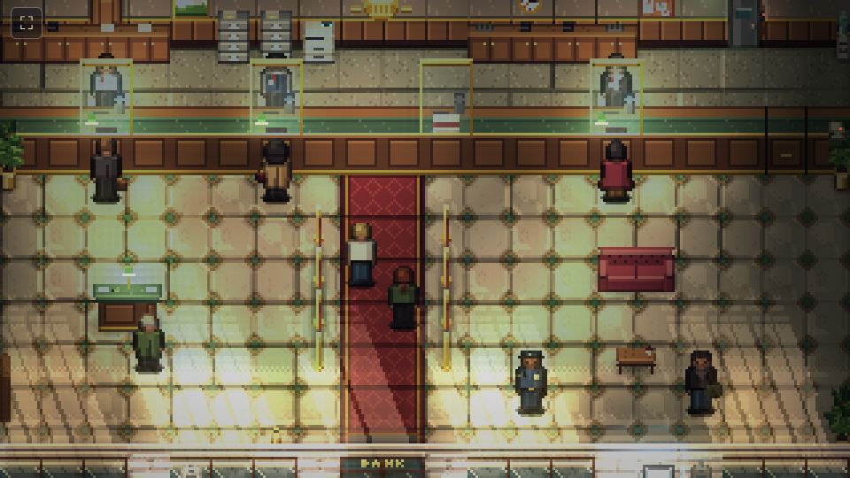

# Visual preview: the example bank

A hand-made example level whose only job is to settle how the game looks. It has no rules yet; the stealth demo is
still the default scene. Open it with `npm run dev` and go to `/?scene=lobby`; drag or use the arrow keys to look
around. Built so far: **the lobby and the street in front of it**. The rest of the bank follows once the lobby's look
is agreed.



## Style card

1. **¾ top-down on the 16px grid.** Walls take one tile and stand **1.5 tiles tall**: a 24px face where the tile
   south of the wall is open, under a cap the depth of the tile, both lifted so they overlap the floor (and anyone)
   up to 1.5 tiles behind the wall. Half-height objects such as the counter have a 15px front, so full walls and half
   cover read apart at a glance. The shop front is a thin wall of stone and see-through glass. People are 16x24 and
   **stand in the middle of their tile**; depth follows each object's base line.
2. **Every object is a box in a real scale** (`src/level/space.ts`, `src/level/catalog.ts`): 1px is about 8cm, so a
   tile is about 1.3m, people are 1.75m and walls are cut away at 1.9m. Each kind of object has its real width, depth
   and height, an elevation if it hangs, and an alignment within its tiles (centred, against an edge or corner, or on
   the line between two tiles via a two-tile span). Wall dressing stands on the floor tile in front of its wall,
   aligned north, at its height. The scene places, orders, shades and lets each box block the sun from those numbers;
   a test checks that no two boxes intersect and nothing stands inside a wall. **Every prop has four facings**, each
   drawn by hand as pixel art on a `View` that knows the projection, from one set of measurements per object so the
   views agree (`van.ts`, `furniture.ts`, `dressing.ts` and `street.ts` in `src/art/bank/`). Boxy furniture is built
   from parts whose faces are each painted for the view; round things (bins, the hydrant, posts, the planter) are drawn
   as curves with curved normals, and organic ones freehand: the rubber plant's oval leaves spiral round its stem, so
   each facing shows another side of the same plant. `/?scene=props` shows them all. ([sheet](../pixel-art/examples/props-four-facings.png): south, east, north, west.)
   Floor tiles are square and heights are drawn at full scale, but the **tops of things are drawn at 2/3 of their
   depth** (`TOP_DEPTH`), the usual cheat for a camera a little lower than 45°: a van nose-on is then 62px tall
   rather than 95px against 54px side-on, so it reads as lying down
   ([comparison](../pixel-art/examples/van-depth-compare.png): full depth on top, half below; we use two thirds).
   Things flat on the floor keep their full depth, and rows of posts keep each post on its floor position.
3. **Muted, hue-shifted ramps** (`src/art/palette.ts`). Darks drift cool, lights warm, the lightest steps desaturate.
   No pure black: the darkest colour is a cool ink. One ramp per material, so greens stay green.
4. **Zones are drawn into the floor** (§8.1): cream marble and a red runner for Public, linoleum for Staff; concrete and
   steel plate will mark Secure. The lobby floor is kept calm and mid-valued so the safe-floor overlay stays readable
   on top of it.
5. **Flat albedo, light in the engine.** Sprites carry only material detail and a little top-light; Light2D and the
   normal maps (from per-colour heights) do the shading. Sel-out outlines on figures, never black ones.
6. **One sun.** It sits low in the south-east, behind the viewer: shafts through the façade glass run up and to the
   left, and everything outdoors casts a shadow the same way.
7. **Readable first.** Silhouette and value contrast against the floor before detail; a contact shadow under everyone.

## Layout

Fixed orientation per §17.1: street along the bottom, public space at the front, the secure core at the top. A small
city branch, roughly 40x30 tiles with the street.

```
              ALLEY: back door, dumpster, generator, manhole (sewer route)
 ┌─────────────┬───────────────────────┬─────────────┐
 │ Electrical  │  Vault antechamber    │ Deposit     │   Secure
 │ alarm panel │      [ VAULT ]        │ boxes       │
 ├─────────────┴───────────────────────┴──────┬──────┤
 │            Staff corridor (2 wide)         │ CCTV │   Staff
 ├──────────┬──────────────────────┬──────────┤ rec. │
 │ Manager  │ Teller line          │ Break    ├──────┤
 │ office   │ ══════ counter ═════ │ room     │Clean.│
 ├──────────┤        LOBBY         │          │closet│   Public (lobby, WC)
 │ WC       │                      ├──────────┴──────┤
 └──────────┴────── façade ────────┴─────────────────┘
   sidewalk: street lamps, ATM in the wall, bollards, news box, hydrant
   road: parked van, centre line, manhole
```

The built part, `src/level/lobby.ts` (legend in the file):

```
######################
###d##############k###   back wall: manager's office door, keycard staff door (exit sign above)
#,,,,,,,,,,,,,,,,,,,,#   teller line (Staff): back counters, filing cabinets, printer, water cooler
#,,,,,,,,,,,,,,,,,,,,#   tellers stand here
#,,,,,,,,,,,,,,,,,,,,#   counter: 4 windows behind teller glass, one closed, a gate at the right
#........==..........#   lobby (Public): runner from the doors to the counter, queue rails along it
#........==..........#
w........==..........#   restroom door in the left wall
#........==..........#   writing desk, sofa and coffee table, plants, brochure rack, guard post
#........==..........#
#........==..........#
#........==..........#
pgggpgggpDDpgggpApgggp   façade: stone piers, windows with blinds, glass doors ("BANK"), ATM
ssssssssssssssssssssss   sidewalk
ssssssssssssssssssssss
cccccccccccccccccccccc   curb
rrrrrrrrrrrrrrrrrrrrrr   road
llllllllllllllllllllll   centre line
rrrrrrrrrrrrrrrrrrrrrr
rrrrrrrrrrrrrrrrrrrrrr
```

## Sprites

Everything is generated in code (`src/art/bank/`): `tiles.ts` (tileset), `furniture.ts`, `dressing.ts`, `street.ts` and
`van.ts` (props, each with an unlit glow layer and the lights it gives off, dispatched by `props.ts`), `people.ts` (one
parametric `person()` for the whole cast).

| Area | Done | Still to make |
| --- | --- | --- |
| Floors | lobby marble (3 variants), red runner, linoleum, sidewalk (2x2 slabs), curb, road, centre line | concrete, steel plate, carpet for offices, tiled WC |
| Walls | cap, plaster and wainscot face, wood door, keycard door, door in a side wall | Soft and Reinforced variants (§14.2), vault wall with rivets, broken and holed walls |
| Façade | stone pier, window with blinds, glass doors with gold leaf, ATM | blinds down (§14.3), broken glass |
| Lobby props | teller counter, back counter, filing cabinet, printer, water cooler, crest, clock, painting, notice board, exit sign, CCTV camera, queue rails, mat, writing desk, sofa, coffee table, plant, brochure rack, bin | flipped table (half cover), breakable dressing and its damage states (§20.9) |
| Street | street lamp, hydrant, news box, bin, bollard, manhole, panel van | police car, cones, barrier, scaffolding, neighbour fronts |
| People | 13 looks, front and back: tellers, guard, customers, passer-by, two crew | side views, walk cycles, manager, cleaner, IT tech, police and SWAT, masked crew, downed and tied poses |
| Back of house | | staff corridor, office, break room, closet, CCTV room, electrical closet, vault and antechamber, alley |

## Lighting model

Light2D lights have no occlusion, so a sun light over the street would shine straight through the façade into the
lobby. The preview splits the job instead:

- **Half exposure, then an exposure layer.** The scene renders at half brightness: ambient is half the street's
  sunlight. A full-screen layer drawn with a custom `2 × source × destination` blend then doubles the street and scales
  the inside down to the building's shade, lifting towards the glass. Rendering at half first leaves the lamps
  headroom; with a plain multiply the interior clipped to white before it was darkened, and every lamp pool vanished.
- **Lamps are Light2D** (about 23 of the 32 allowed): warm pools over the lobby, brighter ones over the teller line,
  banker's lamps on the counter, cyan from the teller monitors and the ATM, green from the exit sign. The interior is
  meant to read as a believably lit bank, with the grit coming from the shade between pools and the dark corners,
  not from dimness.
- **Baked light maps** (`src/art/bank/lightmap.ts`): ambient occlusion along the foot of walls and under furniture
  (multiply, floor only), sun shafts through the glass with the far end striped by the blinds (additive, banded,
  dithered only where bands meet), people and furniture cutting their shadow out of the shafts, and sheared sun
  shadows for everything outdoors.
- **Emissive bits** (screens, lamp shades, LEDs, the exit sign) are unlit sprites, with a second additive pass over
  the exposure layer so they still glow indoors.
- **Atmosphere:** slow cloud shadows drift over the street, dust motes hang in the shafts, a light bloom and a soft
  vignette on the camera.

## Open questions

- Tall walls hide what stands just north of them. That is fine for back walls, but for the shop front and other south
  walls a cutaway (fading the wall when a crew member or a threat is behind it) will probably be needed in play.
- Daytime only for now. Closing time (warmer, lower sun) and a power cut (§8.13: emergency lights only) would reuse
  the same layers with different values.
