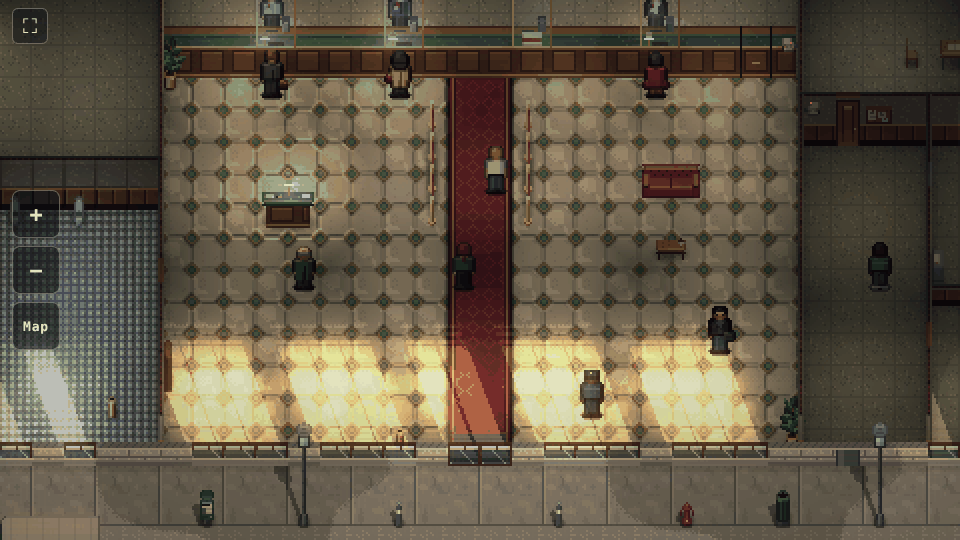

# Visual preview: the example bank

A hand-made example level whose only job is to settle how the game looks. It has no rules yet. It is the default page
(`/`, also `/?scene=bank`); the old stack demo lives on at `/?scene=demo`. Built: **the whole plot** (§17): a city
branch mid-block with every room of a small bank, a café sharing its west wall, a vacant shop to the east, the alley
behind, the street in front and, across it, an office tower between two plazas with the crew's **sniper nest** on its
upper floor (§14.5). About 60x44 tiles, furnished and peopled, with guards and passers-by on patrol.



## Camera (§20.1)

Drag to pan, or use the arrow keys. The mouse wheel, a pinch, the `+`/`−` buttons on the left edge or the `+`/`-` keys
zoom between about 11 and 34 tiles high, in whole-number steps so every art pixel covers a whole number of screen
pixels (`src/logic/zoom.ts`). The **Map** button (or `M`) jumps to the tactical map, the whole plot at the largest zoom
that fits, with every wall cut down; pressing it again or zooming in returns to the view before it. The canvas renders
at the screen's device pixels divided by the zoom and the browser scales it up by that whole number, so the art stays
crisp at any zoom and a closer view draws fewer pixels. The camera's middle can reach every tile.

## Style card

1. **¾ top-down on the 16px grid, walls between tiles.** Walls stand on the edges between tiles at their real
   thickness (a plaster partition 3px, the vault's concrete 5px, the shop front 4px), so every tile is floor and a thin
   wall seen side-on is a thin line. A full wall is cut away at 1.9m (24px); its top, wherever it is cut, shows the wall
   in section, dark and hatched like an architect's plan, which is what tells a wall from half cover such as the counter
   (15px, a finished top). **Walls north of the middle of the screen stand full height** as the backdrop; walls south
   of it drop to a 0.6m stub, so the floor and anyone behind them stay in view. As the camera moves, a wall steps
   between the two over a tenth of a second, with a dead band so nudging the camera doesn't make it flicker; outer
   walls with nothing behind them always stand. Dressing hung on a cut wall goes with it, except what matters for play
   (cameras, card readers). A door in a north-south wall is edge-on to the camera, so its leaf hides in the wall: its
   casings stand proud of both faces, with a handle each side and a threshold on the floor, and those show the door.
   People are 16x24 and **stand in the middle of their tile**; depth follows each object's base line. ([lobby](../pixel-art/examples/bank-preview-lobby.png), [looking past the back wall into the
   corridor](../pixel-art/examples/bank-preview-corridor.png), [the street, the fronts standing](../pixel-art/examples/bank-preview-street.png),
   [the vault](../pixel-art/examples/bank-preview-vault.png), [the café](../pixel-art/examples/bank-preview-cafe.png),
   [the office tower and the nest](../pixel-art/examples/bank-preview-nest.png),
   [the tactical map](../pixel-art/examples/bank-preview-map.png).)
2. **Every object is a box in a real scale** (`src/level/space.ts`, `src/level/catalog.ts`): 1px is about 8cm, so a
   tile is about 1.3m, people are 1.75m and walls are cut away at 1.9m. Each kind of object has its real width, depth
   and height, an elevation if it hangs, and an alignment within its tiles (centred, against an edge or corner, or on
   the line between two tiles via a two-tile span); pushed against a wall, it stands against the wall's face. Wall
   dressing stands on the floor tile in front of its wall,
   aligned north, at its height. The scene places, orders, shades and lets each box block the sun from those numbers;
   a test checks that no two boxes intersect and nothing stands inside a wall. **Every prop has four facings**, each
   drawn by hand as pixel art on a `View` that knows the projection, from one set of measurements per object so the
   views agree (`van.ts`, `furniture.ts`, `dressing.ts`, `street.ts`, `rooms.ts` and `outside.ts` in `src/art/bank/`). Boxy furniture is built
   from parts whose faces are each painted for the view; round things (bins, the hydrant, posts, the planter) are drawn
   as curves with curved normals, and organic ones freehand: the rubber plant's oval leaves spiral round its stem, so
   each facing shows another side of the same plant. `/?scene=props` shows them all. ([sheet](../pixel-art/examples/props-four-facings.png): south, east, north, west.)
   Floor tiles are square and heights are drawn at full scale, but the **tops of things are drawn at 2/3 of their
   depth** (`TOP_DEPTH`), the usual cheat for a camera a little lower than 45°: a van nose-on is then 62px tall
   rather than 95px against 54px side-on, so it reads as lying down
   ([comparison](../pixel-art/examples/van-depth-compare.png): full depth on top, half below; we use two thirds).
   Things flat on the floor keep their full depth, and rows of posts keep each post on its floor position.
3. **Muted, hue-shifted ramps** (`src/art/palette.ts`). Darks drift cool, lights warm, the lightest steps desaturate.
   No pure black: the darkest colour is a cool ink. One ramp per material, so greens stay green.
4. **Zones are drawn into the floor** (§8.1): cream marble and a red runner for Public, linoleum for Staff, concrete
   and the vault's steel plate for Secure; the neighbours have their own (the café's floorboards, the vacant shop's
   dusty boards). The lobby floor is kept calm and mid-valued so the safe-floor overlay stays readable
   on top of it.
5. **Flat albedo, light from the lamps.** Sprites carry only material detail and a little top-light; the lamps and
   the normal maps (from per-colour heights) do the shading. Figures are edged like the furniture: their own outermost
   pixels on the sides and bottom a shade darker (`PERSON_EDGE`), nothing drawn outside the silhouette and never black;
   a ring around them made them look like cartoon stickers (`docs/pixel-art/examples/character-edges.png`).
6. **One sun.** It sits low in the south-east, behind the viewer: shafts through the façade glass run up and to the
   left, and everything outdoors casts a shadow the same way.
7. **Readable first.** Silhouette and value contrast against the floor before detail; a contact shadow under everyone.

## Layout

Fixed orientation per §17.1: the street along the bottom, public space at the front, the secure core at the back, the
alley behind. The plan is `src/level/bank.ts`, drawn at double resolution: floor tiles at odd columns and rows, walls
on the edges between them (legend in `src/level/plan.ts`). Its rooms (`BANK_ROOMS`) name each part, give it a zone and
say how it is lit; the lamps hang from them. Simplified, x in tiles:

```
 0         10    16  20            34      42      50        59
 ════════════════ brick wall: the backdrop ══════════════════════   row 1
  alley: dumpster, bins, generator, roof ladder, sewer manhole, the bank's back door  rows 1-3
 ┌─────────┬─────┬───┬─────────────┬───────┬───────┬─────────┐
 │ café    │elec-│ser│    VAULT    │deposit│ back  │ vacant  │   Secure core: concrete walls,
 │ kitchen │tri- │ver│ steel walls │ boxes │ hall  │ back    │   the vault's steel, keycard doors
 ├─────────┤cal  │   ├──── door ───┤       │       │ room    │
 │         │     │   │ antechamber │       │       ├─────────┤
 │         ├─────┴───┴─────────────┴───────┴───────┤         │
 │  café   │          staff corridor               │ vacant  │   Staff
 │         ├─────────┬────────────────────┬────────┤ shop    │
 │ window  │ manager │ teller line        │ break  │         │
 │ seats   │ office  │ ═════ counter ════ │ room   │ boarded │
 │         ├────┬────┤                    ├───┬────┤ windows │
 │         │ATM │WCs │       LOBBY        │pas│CCTV│         │   Public
 │         │room│    │                    │sag├────┤         │
 │         │    │    │                    │e  │clea│         │
 └─glass───┴────┴────┴─pier window DOOR───┴───┴────┴─shutter─┘   street fronts, row 28
   sidewalk: street lamps, ATM in the wall, bollards, news box, hydrant, café tables
   road: parked van, centre line
   far curb and sidewalk: street lamps, hydrant, news box                                rows 36-38
 ┌──────────────┬──────────────┬────┬───────┬───────┬──────────────┐
 │ west plaza   │ tower lobby  │sta-│ NEST  │office │ east plaza   │   glass curtain wall on the street
 │ trees,       │ reception,   │irs │(up)   │to let │ trees,       │   rows 39-43
 │ benches      │ sofa         │ ↑  │       │(up)   │ benches      │
 └──────────────┴──────────────┴────┴───────┴───────┴──────────────┘
```

**Height is a tile property** (§14.7). The nest and the office beside it are raised tiles a storey up (3.5m,
`RAISED_HEIGHT` in `plan.ts`), drawn in place on the grid like every other floor, so the overlays line up with them. The
stairwell shows the height: a flight of stairs climbs north from the stairwell floor to a landing, a railing runs
along the flight and across the landing's open edge, and the landing's drop shows the slab's face. `floorHeight` gives
each tile's height; the tests walk from the sidewalk to the nest, never up or down more than a step, never over a
railing.

## Sprites

Everything is generated in code (`src/art/bank/`): `tiles.ts` (tileset), `walls.ts` (every wall kind at each height,
packed into one atlas), `furniture.ts`, `dressing.ts`, `rooms.ts` (back of house), `outside.ts` (the café, the
alley, the plazas and the nest), `street.ts` and `van.ts` (props, each with an unlit glow layer and the lights it gives off, dispatched by
`props.ts`), `people.ts` (one parametric `person()` for the whole cast).

| Area | Done | Still to make |
| --- | --- | --- |
| Floors | lobby marble, red runner, linoleum, concrete, steel plate, white tiles, café floorboards, dusty boards, granite, office carpet tiles, stairs, plaza pavers, alley tarmac, sidewalk, curbs on both sides, road, centre line | carpet for the bank's offices |
| Walls | plaster with a walnut wainscot, painted concrete block, the vault's riveted steel and its round door, brick, wood door, keycard door, steel service door, a railing (never cut), each with its section on top and drawn at any height; side-on doors by their casings | broken and holed walls, open doors |
| Fronts | stone and brick piers, windows with blinds, glass doors with gold leaf, the ATM, boarded windows, a rolling shutter, the tower's glass curtain wall and doors | blinds down (§14.3), broken glass |
| Lobby | teller counter, back counter, filing cabinet, printer, water cooler, crest, clock, painting, notice board, exit sign, CCTV camera, queue rails, mat, writing desk, sofa, coffee table, plant, brochure rack, bin | flipped table (half cover), breakable dressing and its damage states (§20.9) |
| Back of house | deposit boxes, cash shelves and cart, vault console, server racks, alarm and breaker panels, CCTV desk, desks and chairs, bookshelf, lockers, shelving, mop bucket, the ATM's back, boxes, dining table, fridge, kitchen counter, toilets, washbasins | |
| Neighbours and alley | café tables, café counter, menu board, dumpster, generator, roof ladder, street trees, benches, the sniper's rifle case | |
| Street | street lamp, hydrant, news box, bin, bollard, manhole, panel van | police car, cones, barrier, scaffolding |
| People | 18 looks, front and back: tellers, guards, manager, operator, cleaner, barista, customers, passer-by, three crew (Sol in the nest) | side views, walk cycles, IT tech, police and SWAT, masked crew, downed and tied poses |

## Lighting model

Phaser's Light2D lights have no occlusion: a light shines through any wall. The preview doesn't use them; it splits
the job instead:

- **Half exposure, then a baked exposure.** Light is worked out at half brightness (ambient is half the street's
  sunlight), which leaves the lamps headroom, and then each baked texture is multiplied by an exposure
  (`buildExposure`): twice for the street and the alley, the building's shade indoors, lifting towards the street
  glass (the bank's front, and the tower's front across the street, behind which a patch of cool sky light falls).
  Exposing each texture rather than the screen means a wall that stands in front of the street takes the street's
  exposure along its whole face. The cloud shadows' top edge follows the bank's front; they stop at the tower's front
  (we see its inside face) and go on over the plazas either side of it.
- **Lamps are baked, and walls block them** (`src/art/bank/lamps.ts`). When the level loads, each lamp's reach is
  traced across the floor against the walls (glass lets light through), and the floor, every wall segment at each of
  its heights, every prop and every person is lit with the same formula Light2D uses, normal maps included: a standing
  thing by the lamps that reach its footprint. By day, lamp light doesn't show outdoors, where the sun drowns it.
  Warm pools over the lobby, brighter ones over the teller line, cool strip lights in the corridor, banker's lamps on
  the counter, cyan from the teller monitors, green from the exit sign. The interior is meant to read as a believably
  lit bank, with the grit coming from the shade between pools and the dark corners, not from dimness. The same reach
  says which tiles are lit, for the rules (`tileLight`; the scene's `debugState.lit`). Baking takes about a second at
  load; a lamp that changes (a power cut, a lamp shot out) only needs its own reach and what it lights rebaked.
- **Baked light maps** (`src/art/bank/lightmap.ts`): ambient occlusion along the foot of walls and under furniture
  (multiply, floor only), sun shafts through the glass with the far end striped by the blinds (additive, banded,
  dithered only where bands meet), furniture cutting its shadow out of the shafts, and sheared sun shadows for
  everything fixed outdoors. People move, so they cast none of these, only their drop shadow; moving one relights
  just its own sprite, with the lamps that reach where it now stands (`BankScene.movePerson`). The guards patrol the
  corridor and the lobby to show it: they brighten in the lamp pools and dim between them.
- **Emissive bits** (screens, lamp shades, LEDs, the exit sign) are unlit sprites drawn additively on top, so they
  still glow indoors.
- **Atmosphere:** slow cloud shadows drift over the street, dust motes hang in the shafts, a light bloom and a soft
  vignette on the camera.

## Open questions

- A full-height wall in the upper half of the screen still hides about 1.6 tiles behind it. In play, people and threats
  there should show as a silhouette through the wall, and the safe-floor overlay and hovering a tile should drop the
  walls in their way.
- Daytime only for now. Closing time (warmer, lower sun) and a power cut (§8.13: emergency lights only) would reuse
  the same layers with different values.
