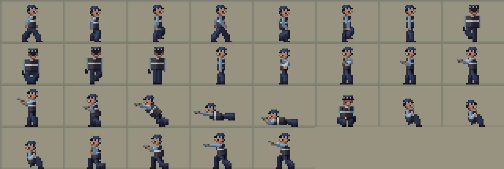

# Animating pixel art

How to animate the game's characters: the rules that matter at 16x24 px, the numbers behind them, how to build frames
in this project's code-generated pipeline, and a beat sheet for the police officer preview. It was put together from
research into pixel-art tutorials (mostly Pedro Medeiros, "Saint11", and Raymond Schlitter, "Slynyrd"), game
animation writing, firearms training material and the Phaser 4.2.1 source. Rules for making still art are in
[PROMPTING.md](PROMPTING.md); background on the pipeline is in [README.md](README.md).

Timings marked as measured were read from the frame durations stored in Saint11's tutorial GIFs. Anything marked
*(low confidence)* rests on secondhand sources or guesses; *(inference)* means reasoning from the sources or from this
game's scale rather than something a source says.

Scale used throughout: 1 px ≈ 8 cm, a 1.75 m person is about 22 px tall in a 16x24 frame, tiles are 16 px, and one
refresh at 60 Hz is 16.7 ms.

## 1. Summary

1. **Pose to pose.** Draw the 2–4 key poses of an action, time them with as few frames as possible, and add
   in-betweens last, only where the motion still looks jerky. Too many in-betweens make a move sluggish.
2. **Every frame has its own hold.** 80–100 ms per pose is the tutorial norm for brisk actions, about 300 ms on a key
   pose. Uniform timing looks mechanical. Pick multiples of 16.7 ms (50, 67, 83, 100, 117, 133 …). A calm walk locked
   to the game's walking speed runs slower than that (171 ms a frame, section 3).
3. **The fast part gets the fewest frames.** Cut the in-betweens of a dive or a draw and use one smear or stretched
   frame instead; spend the frames on anticipation and recovery.
4. **NPC anticipation is long; it is the telegraph.** Its first frame must already change the silhouette, and the
   readable pose is held at least 300 ms (we use 300–450 ms). In the turn-based game the tell is a pose held for the
   whole crew phase, not just a wind-up inside a clip (section 5).
5. **Lock travel to the stride.** Move the figure a fixed whole number of pixels per walk frame, equal to how far the
   planted foot slides back in the drawing. Change speed with the frame duration, never the step.
6. **Whole pixels only.** Keep positions as floats in logic if needed, but round once from the foot anchor and place
   the sprite, shadow, muzzle flash and shells from that same rounded point.
7. **Generate every frame from one parametrised pose.** Unchanged parts stay pixel-identical, clusters never break
   and nothing boils. Test it by diffing consecutive frames.
8. **Mass never changes.** Squash one way, stretch the other. On a 22 px figure, 1 px is the whole squash budget, and
   a stiff, geared-up officer squashes by bending, not by deforming.
9. **Bob 1 px, as a triangle wave, not a sine.** Walking away from the camera bobs less than walking towards it.
10. **Fake sub-pixel motion with light, not shape.** Shift colours and highlights inside a fixed silhouette for
    breathing and idles. Keep the gun and head on whole-pixel moves, because they carry the meaning.
11. **A shot is a 1-frame flash, a recoil frame that moves the body as well as the gun, and a settle.** Put at least
    3–4 non-flash frames between two flashes, or they read as one.
12. **Overlap and overshoot.** Stagger body parts by a frame, recover on a different arc from the action, overshoot
    1 px on the last recovery frame, and end on the idle or aim pose so actions chain.
13. **Effects carry the speed and leave traces.** Flash, smear, dust, shells and bullet marks are separate sprites;
    the shells and marks stay behind so a viewer can count the shots afterwards.
14. **Never rotate pixel art.** Draw each facing and each aim pose by hand. Mirror only symmetric views, redraw
    one-sided gear, and regenerate the normals from the mirrored heights.
15. **A loop's last frame must lead into its first.** A long scripted sequence needs an explicit way back to its start
    pose, position and gun state (holstered or drawn), or the seam pops.

## 2. Fundamentals

### Keys first, in-betweens last

Saint11's planning order is: a still frame (usually the first idle frame), rough sketches to plan the timing,
keyframes ("frames that define an animation, important poses"), then in-betweens ("copy-pasting helps a lot, adjust
timing"). Slynyrd: keyframes "should be the most dramatic poses that capture the essence of the motion", and "too many
in-between frames can make your motion look sluggish". Thomas Vasseur on Dead Cells: once the animation is convincing
"with the least amount of frames possible", he adds interpolation frames "before or after the key frames. Never
in-between". Dead Cells attacks are "essentially pose-to-pose animations" with the effects carrying the motion.

Slynyrd also blocks one body part at a time across all frames: legs first, then arms, then head and body, each part
in its own flat colour while blocking.

### Timing

Measured from the tutorial GIFs and from published game tables:

| Source | Animation | Per frame | Notes |
| --- | --- | --- | --- |
| Saint11 | Walk, top-down walk, top-down run | 100 ms | measured |
| Saint11 | Simple run, squash, motion blur, impact | 80 ms | measured |
| Saint11 | Attack sheet | 300 ms, then 8 × 100 ms | first pose held |
| Saint11 | Top-down attack | 80 ms, one frame 120 ms | the long frame is the hold |
| Saint11 | Bullets | 60 ms | measured |
| Saint11 | Bouncing ball (beginner article) | ground rest 300 ms | set per frame |
| Slynyrd | Run | 8 × 80 ms or 4 × 160 ms | cycle stays 640 ms (Pixelblog 8) |
| Stardew Valley | Walk | 4 × 200 ms (3 drawings) | stand, step, stand, step |
| Stardew Valley | Run, facing down or up | 90, 60, 120, 60, 90, 60, 120, 60 ms | extremes held longest |
| Stardew Valley | Run, side | 90, 140, 100, 90, 140, 100 ms | 6 frames; the side view is the one the officer's east walk uses |

The Saint11 numbers are the GIFs' frame ticks, not hold times per pose. The pages are 512x512 tutorial sheets, and he
makes holds by repeating a frame: his idle GIF is 60 frames at a uniform 100 ms but only 37 of them are distinct. The
Slide-Roll GIF is 16 frames of 80 ms for the slide, the roll and the dash together, so the roll's frame count below is
a count of its poses, not a measurement.

At 60 Hz, 80 ms is about 5 refreshes and 100 ms is 6. Durations that aren't a multiple of 16.7 ms round unevenly from
frame to frame.

### Principles at low resolution

- **Anticipation** moves the body or weapon the opposite way first. Saint11's "anatomy of an impact" runs idle,
  anticipation, motion (the shortest part), overshoot, rest. He notes anticipation is "usually avoided when drawing
  player characters"; Jonathan Cooper (Game Anim): "Anticipation lengths are generally longer for NPCs to allow the
  player time to react". Section 5 turns this into the game's telegraph.
- **Squash and stretch:** "mass never changes. When changing the width of an object, always change the height too."
  Stiff objects deform less. Saint11's 2-frame idle is the whole budget at this size: down 1 px with arms out and knees
  bent, then up 1 px with arms down.
- **Easing comes from spacing.** Bunch frames near the start and end positions. "Back in/out" (anticipation plus
  overshoot) suits attacks, and Saint11 sometimes skips or distorts the middle frame to make a move stronger. His
  bouncing ball moves 4, 3, 2, 1 px on successive frames, then holds a frame at the top. Easing can also be done in
  code by tweening the position.
- **Follow-through:** recover "in a different motion arc than the attack" and overshoot on the last recovery frame.
  Cooper recommends holding strong poses in this phase so the player sees them, and ending on a designated pose so
  the next animation can follow.
- **Overlapping action:** Cooper names "all elements of a character start or arrive at the same time" as a common
  mistake. At this size it costs no drawings: the head leads a turn by a frame, the gun arm settles a frame after the
  body lands.
- **Hit-stop:** Saint11 pauses one frame before an impact, "only for very exaggerated impacts". Nuclear Throne freezes
  10–20 ms "whenever you hit something", not when firing. Sakurai (Smash): "Projectiles have comparatively less
  hitstop" than other attacks, and the shake is visual only. For a pistol in a tactical game: no hit-stop on the
  shooter, and at most a puff and a 1 px nudge on what is hit.

### Smears and motion blur

For fast actions, "remove frames between rest and target position for a faster and stronger movement" and add motion
blur (Saint11, Impact). The first frame of a slash "should do the full motion", then the blur fades over the next
frames. A smear "is trying to connect it to the previous frame": lighter colours bleed over darker ones, darker
colours are used for fading, and each colour is smeared on its own (Tiny Warrior Games). Smears work best on larger
sprites and on areas with little important detail, so on the officer use them on the body and limbs during a dive or
a draw, not across the face or the gun.

### Sub-pixel movement

"You can't [move less than 1 px], but you can fake some very subtle movements" (Saint11). The tricks: move part of the
shape first, move the interior before or after the silhouette, slide the points where a line breaks, fade colours,
and "mostly move light, avoid moving shapes". Too many in-between colours make everything look blurry. Metal Slug's
34 px Fio breathes through colour shifts, with 4 pixels toggling on her ponytail *(secondhand, via Bradley Oberg
crediting Ansimuz)*. In this pipeline a highlight moves when its pixels' heights change, because the normal map comes
from the heights.

### Avoiding boiling and jitter

- **Boiling:** "Keep track of clusters", avoid orphan pixels and unnecessary dither (Saint11). In a loop a single
  misplaced pixel stands out (Slynyrd), and clothing fold lines should stay minimal and consistent across frames.
  Dead Cells, rendering 3D down to 50 px characters, never solved its flickering pixels. Drawing every frame from one
  set of measurements avoids the problem here.
- **Foot sliding:** the planted foot "always moves towards the back" (Saint11). If the figure moves by a different
  amount, it moonwalks or marches in place.
- **Jitter:** fractional sprite or camera positions on a nearest-neighbour target shimmer, and a sprite and its
  shadow rounded separately can land on different pixels. Phaser forum threads report jitter from follow-lerp at
  fractional positions; the fix is rounding the position yourself. See section 6.

### Frame budgets

| Action | Frames | Source |
| --- | --- | --- |
| Idle | 2 (bounce), 3 (smoother fall, delayed face), 6 (secondary motion) | Saint11 |
| Walk | 4 minimum, 6 good at low resolution, 8 the balance of fluidity and economy | Saint11, Slynyrd (Pixelblog 50: 4, 6 or 8) |
| Run, top-down | 4 minimum (second half mirrored), or 3 jump + 2 recover per stride; 6 in Slynyrd's | Saint11, Slynyrd (Pixelblog 55) |
| Slide | 1 prepare, a short loop, 2 recover | Saint11 |
| Roll or dive | about 7 poses, on 80 ms ticks | Saint11 (counted from the Slide-Roll GIF) |
| Attack | 4–8, pose to pose | Saint11, Dead Cells |

Slynyrd: "tiny sprites limit the motion you can depict." Dead Cells works at about 50 px; at 22 px, put the detail
into the poses and read the limbs from high-contrast hands and feet.

### Loops

"An animation loop is an animation where the last frame also works as a frame that would come before the first
frame" (Saint11). Sub-loops of different lengths that don't start together hide the seam; "making animations with
different durations confuses the eye".

## 3. Top-down locomotion

### Views

For four-way movement draw three views (towards the camera, away, side) and mirror the side view, unless the design
or the lighting is asymmetric (Slynyrd, Pixelblog 22). Sixteen-bit games such as A Link to the Past and Secret of
Mana used four views for eight-way movement. Five views, flipped, cover eight directions (Pixelblog 55). On a police
officer, the holster, radio and badge are one-sided, so
mirrored frames need those redrawn, and a view whose lighting differs left to right needs its own drawing.

Saint11's stacking order for ¾ top-down: feet behind legs, legs behind torso, torso behind head. Think of head, body
and feet as three shapes on top of each other that shift by single pixels.

### The walk cycle

The six side-view poses (Saint11), three per leg:

| # | Pose | What happens |
| --- | --- | --- |
| 1 | Contact | front foot first touches the ground |
| 2 | Down | the impact lowers torso and head |
| 3 | Down+ | lowest frame, arms at their widest |
| 4 | Prepare passing | about to rise; the head lags a frame |
| 5 | Passing | moving up, legs crossing |
| 6 | Up | highest point |

Arms move with the opposite leg; the leg on the ground always moves backwards. Slynyrd's head path is a triangle wave:
"if the head position across the sequence creates a perfect sine wave, the uniform motion feels a bit unnatural"
(Pixelblog 50). His six-frame top-down run moves the head down 1, down 1, up 2, so it rises faster than it falls, and
he gives its frames different holds: "Uniform playback speed at any rate felt a bit robotic" (Pixelblog 55).

Per view:

- **Towards the camera:** move one leg forward while the arm on the same side swings back, for three frames, then flip
  them for the other leg (Saint11's basic six-frame cycle). At 22 px the legs are only 8–9 px long, so a stride shows
  as the feet 1–2 px apart vertically rather than as a leg angle *(inference)*.
- **Away from the camera:** "less aggressive vertical movement on torso and head. Same logic of front anim." The head
  hides the face, so the arms and the soles flashing under the body carry the motion.
- **Side:** like a platformer walk, with "strong contrast points on hand and feet". The far leg is mostly hidden;
  darkening it one shade makes it read as behind.

Duplicating every frame with an intermediate pose gives twelve frames; that is polish, not a requirement.

### Timing and stride

Measured tutorial cycles run at 100 ms per frame (a brisk 600 ms six-frame cycle); Stardew walks at 4 × 200 ms.
Real walking cadence is about 100–120 steps a minute, 1.0–1.2 s per two-step cycle. A Link to the Past holds each walk
step for only 1–3 game frames, uneven *(medium confidence: read from the zelda3 reimplementation, and the mapping from
steps to drawings was not fully traced)*.

The step size follows from the scale *(inference)*: a 1.4 m/s walk is 17.5 px/s, and a 0.7 m step is about 9 px. The
game's patrols walk at exactly that speed (`WALK_SPEED = px(1.4)` in `src/scenes/BankScene.ts`), and the preview should
match it, so a preview walk and a patrol look the same.

| Cycle | Per frame | Step per frame | Per cycle | Speed |
| --- | --- | --- | --- | --- |
| 6 frames, side | 171 ms | 3 px | 18 px in 1.03 s | 17.5 px/s, the game's walk |
| 4 frames, back or front | 229 ms | 4 px | 16 px (one tile) in 0.92 s | 17.5 px/s, the game's walk |
| 6 frames, side | 100–120 ms | 3 px | 18 px in 0.6–0.7 s | hurried walk |

At 171 ms (about 6 fps) the walk is far slower than the 80–100 ms tutorial norm. That follows from locking a 3 px stride
to a 17.5 px/s walk; the tutorial cycles are brisker walks with bigger strides. If 6 fps looks choppy, double the
cycle to 12 frames at about 86 ms with steps alternating 1 and 2 px (drawn to match), rather than shrinking the stride
or gliding.

The MonoAGS engine makes this the default: the character moves only when the walk frame changes, by a fixed walk step,
because unlinked movement "will also cause a gliding effect" *(medium confidence)*. A walk should stop after a whole
number of steps (half cycles), on a contact or stand frame with the foot planted. With a 3 px step, a step is 9 px and a
cycle 18 px, which never lines up with 16 px tiles over a short walk (48 px, three tiles, is 2⅔ cycles). Pick one:

- **Place the start, not the end.** Choose the end tile and put the start a whole number of steps before it; in a loop
  the seam hides where the start falls. The preview does this.
- **Draw the cycle to cover one tile:** steps of 3, 3, 2, 3, 3, 2 px (16 px a cycle), with the planted foot drawn
  sliding back by the same amounts.
- **Absorb the rest** (1–2 px) in the stop pose.

If the speed has to vary, choose the frame from the distance travelled rather than from time *(inference)*.

For reference, Pokémon Gen 3 walks 1 px per frame for 16 frames per 16 px tile and runs 2 px per frame over 8
*(secondary source)*.

### Bob, idle and turns

- **Bob:** 1 px from down to up on a 22 px figure, 2 px at the head in a run at most. Less in the back view.
- **Idle:** 2–3 frames, with the extremes held longer than the in-between *(inference, from Slynyrd's uneven run timing
  above; Saint11's idle gets the same effect by repeating frames on a uniform tick)*. Move the face a frame after the
  silhouette, and let horizontal movement compensate the vertical, because "vertical movement alone is boring"
  (Saint11).
- **Turns:** with no dedicated turn frames, step through the in-between facing for about one frame, or hold the new
  facing's idle for about 100 ms before walking on *(inference; a Construct forum answer suggests playing a turn
  animation and then switching)*. Without diagonal views, a cheap in-between is the old body with the new facing's head
  for one 83–100 ms frame (the officer rig's `look`), so the head leads the turn. To check that views agree, put them
  all at the same anchor and play them as an in-place rotation; "one pixel can make a huge difference" (Slynyrd).
- **Secondary motion:** shift hair or cloth on 2 of 6 frames and move highlights a small, steady amount (Slynyrd). On
  the officer the candidates are the cap brim, the radio cord and the holster flap.

### Runs

A run has a moment with neither foot down, so the body is highest while the legs are stretched; in a walk it is
highest at passing. Saint11's minimal top-down run is 4 frames, the second half mirrored "except for the hair and
other asymmetries", with exaggerated arm swing.

### Shooters' bodies *(low confidence)*

Arcade shooters often give the body a few facings and rotate a separate gun towards the aim (described as the
Nuclear Throne pattern), and pure top-down games are said to split legs (following movement) from torso (following
aim). No primary developer source confirms either. At this scale a pistol is about 2.5 × 1.75 px, so rotating it only
makes noise: draw the aim poses instead.

## 4. Combat

The officer's actions, each as a frame table. Durations are per frame. Unless a row cites a source, the split into
frames is *(inference)* from the principles above and the real-world timings quoted.

### Draw

A police draw stroke has four steps with real timings (Mike Boyle, Police and Security News): grip the holstered gun
while the support hand goes to the chest midline (under 0.5 s); lift the gun straight up out of the holster; elbow
back, gun level at high chest with both hands joined (about 0.75 s); arms extended to eye level (about 1.0 s). He
gives no time from there to the shot.

| # | Pose | ms | Notes |
| --- | --- | --- | --- |
| 1 | Turn to face the target | 100 | head leads by a frame if there are two |
| 2 | Hand on holster, support hand to chest, shoulders dip 1 px | 250–400 | **the tell**: elbow out, silhouette changes |
| 3 | Gun clears holster, elbow back | 83–100 | optional 1 px smear on the arm's arc |
| 4 | Gun level at chest, hands join | 83–100 | |
| 5 | Arms extend | 67–83 | |
| 6 | Overshoot 1 px past the aim, then aim | 83 | |
| 7 | Aim hold | 300–450 | the readable intent; move light, not shape, if it looks frozen |

Stance: isosceles reads best (chest square, both arms straight forming a triangle). Seen side-on, both arms collapse
into one horizontal line of about 7–8 px from shoulder to muzzle; draw the far arm a shade darker so it still reads
as two-handed *(medium confidence on stance sources)*. Between the draw and a dive, use a ready position with the
muzzle down or the gun tucked to the chest (low ready, compressed ready or close retention, Police1), so the gun never
sweeps the officer's own body.

### Fire, recoil and the pair

Saint11's pistol shot (60 ms frames, read from his Bullets GIF): one big flash that also lights the shooter, the flash
breaking into a ring, two or three frames of dark smoke while the arm flips up and settles, and a shell that falls for
4–5 frames and stays. Nuclear Throne (Jan Willem Nijman, 320x240 at 30 fps): the bullet's first frame is a circle
that acts as the flash, the bullet then moves 16 px a frame with 0–4° of spread, the gun kicks back 2 px and snaps
back, the camera is pushed 6 px and the screenshake goes up by 4, shells fly 2–4 px a frame at 100–150° off the aim,
and a hit enemy is knocked back 3 px a frame.

| # | Frame | ms | Notes |
| --- | --- | --- | --- |
| 1 | Fire | 50–67 | flash at a fixed muzzle pixel; officer's front lit this frame |
| 2 | Recoil | 83 | flash breaks up or is gone; gun and hands up 1 px and back 1 px; head back 1 px |
| 3 | Settle | 100–117 | back to aim, 1 px overshoot; shoulder follows a frame late |
| 4 | Sight picture | 117–200 | before the next flash |

- **Muzzle flash:** full strength for exactly one frame, optionally a dimmer second; held longer it reads as a flame
  or a jam *(medium confidence)*. Warm, bright core (white-yellow), cooler, darker rim (orange), 3–5 px, a different
  shape on each shot so two shots read as two events. "Muzzle flash and impact shrapnel … communicate the player where
  the bullet starts and ends, especially if the bullet is not visible" (Saint11).
- **Recoil moves the body.** Animating only the gun looks wrong in simple pixel art; the Space Police Hero sprite set
  pairs every pose with a recoil frame where gun and arms move together. Pistol recoil is mostly muzzle rise.
- **Spacing the pair:** real fast pairs ("hammers") are 0.25–0.35 s apart, aimed controlled pairs 0.45–0.8 s (average
  0.6 s) *(medium confidence)*. A trained officer fires a controlled pair. Rows 1–4 above make about 0.4–0.5 s.
- **Shell:** one brass pixel thrown out of the ejection port on the pistol's right side and a little to the rear,
  arcing for about 4 frames, then staying on the floor until the loop resets *(medium confidence on the ejection
  direction)*. The port is on the pistol's right whichever hand holds it, so for a pistol pointing west the case goes
  north (up the screen, away from the camera) and slightly east (back past the shooter's hand), and its arc lifts it
  further up the screen before it drops onto the floor a few pixels north-east of the hand.
- **Bullet:** fast bullets need few frames and are stretched along their path. At Nuclear Throne's 16 px a frame a
  bullet crosses the whole 320 px view in about 20 frames at 60 Hz, which reads slow for a pistol; draw it as a 1 px
  tracer over the whole path for one frame, fading out within about 50 ms, or not at all and let the flash and the
  impact say where it went *(inference)*. Leave a mark or puff where it lands; against cover, show the hit connecting
  without damage: a small burst, a bright point, a tiny movement (Saint11, Defend).
- **Shake:** keep it to 1 px and decaying, cosmetic only, or leave it out. Nuclear Throne's camera numbers are for an
  arcade shooter.

### Dive into cover

Saint11's roll (about 7 poses on 80 ms ticks, so roughly 560 ms; counted, not measured, see section 2): an optional
airborne dive frame before the hands touch, one frame of hands on the ground, four roll frames each slightly varied,
one overshoot recovery frame, one frame back to idle. Enter the Gungeon's roll takes about 0.7 s *(community wiki)*.
Saint11's slide and dash add dust trails, motion blur and a squash-and-stretch tween.

| # | Pose | ms | Notes |
| --- | --- | --- | --- |
| 1 | Gun tucked (compressed ready) | 83 | muzzle down or towards the threat |
| 2 | Crouch: head 2–3 px lower, arms in | 100–150 | anticipation; squash |
| 3 | Launch: stretched 1 px longer, 1 px thinner, smear trailing back | 50–70 | "the first frame should do the full motion" |
| 4 | Airborne | 67–83 | sprite lifted 2–4 px; shadow stays on the floor |
| 5 | Land: squash, dust puff | 80–100 | the gun arm settles a frame later |
| 6 | Slide or roll | 1–2 × 83 | |
| 7 | Turn into cover, back to it, shoulders 1 px past rest | 117–150 | different arc from the dive; overshoot |
| 8 | Settle | 117 | |
| 9 | In-cover hold with breathing | 600–800 | ±1 px or sub-pixel only |

Move the figure with an ease-out curve, snapped to whole pixels, while the frames play the poses; 1–2 tiles is
enough. Section 7 gives the offsets per frame. The hold matters: it is what separates "took cover" from "tripped".

### Cover and peeking

Real officers stay about an arm's length from cover, kneel behind low cover and expose only head, arms and gun to
shoot. Sitting with the back against cover (Metal Gear Solid's wall press, Gears and Uncharted) is a game
stylisation of the moment between shots *(medium confidence)*.

Sizes at this scale *(inference from the project's measurements)*: a 0.85 m sofa is 11 px tall, a 0.9–1.1 m counter
or desk 11–14 px; a kneeling officer's eyes are about 14–15 px up; sitting on the floor against cover puts the top of
the head at 11–12 px, just hidden. Heights are full scale; `TOP_DEPTH` only shortens the top face's depth on screen,
never a height.

**Where the cover is.** Cover protects from one direction, so it goes between the officer and the threat. When he
shoots west, the cover is west of him: he sits against its east face, facing east with his back to the west, which is
a side view; to shoot he turns and kneels facing west, also a side view, and aims across its top. He and the cover
then stand on about the same baseline, so depth sorting doesn't hide him (see section 6); what reads as cover is the
cover's side silhouette next to his.

**Checking the head height.** In 3D, his head must be lower than the cover: sitting 11–12 px against an 11–14 px
cover. On screen, his head must stay inside the cover's drawn outline next to him. With his footing at floor row `y`
and the cover's box at `baseLine(cover)`, that outline's top is at `baseLine(cover) - cover.h - topRows(cover.d)`
(front face plus the rows of its top face), so the check is `y - headHeight >= baseLine(cover) - cover.h -
topRows(cover.d)`. Kneeling to aim, only the head, forearms and gun (2–4 px) may rise above that line.

| # | Pose | ms | Notes |
| --- | --- | --- | --- |
| 1 | Glance over the shoulder or towards the edge | 300–500 | the tell before coming up |
| 2 | Turn to kneel, facing the cover | 100–130 | |
| 3 | Dip 1 px | 83 | anticipation |
| 4 | Rise 3–4 px over two frames | 2 × 100 | sub-pixel shading on the first rows so the head emerges |
| 5 | Aim over the top | 250–300 | only head, forearms and gun (2–4 px) above the edge |
| 6 | Two shots | as above | shells land behind the cover |
| 7 | Duck back, hold | 2 × 100, then about 400 | |

Keep the cover's clusters and the officer's lower silhouette still; only the head and gun arm move.

## 5. Readability and telegraphing

The design promises that no NPC raises an alarm, draws a weapon or breaches without a telegraphed intent (in the
game, *Reach for weapon* shows for one world phase before the NPC turns hostile). The intent marker says it; the
animation has to show it as well. In Mark of the Ninja, guards' "animation poses completely change as they become
much more aggressive" (Giancarlo Valdes, GamesBeat preview), and the designers' rule is that "if a guard's behavior
ever changes, the player will immediately understand what set it off" (the five stealth rules).

### Telegraphs in a turn-based game

The timings below come from real-time games, but this game is played in phases: an NPC's next intent is committed at
the end of the world phase and shown for the whole crew phase, for as long as the player plans (GAME_DESIGN §6.1–6.2).
So in the game *(inference)*:

- **The tell is a held or looping pose, not a wind-up.** An NPC whose intent is to draw shows the tell pose (hand on
  the holster, elbow out, the *Reach for weapon* stance) for the whole crew phase, looping a 2–3 frame idle on it if it
  must look alive, and plays the rest of the draw when the world phase carries the intent out. The same goes for an
  alarm carrier reaching for a phone or button.
- **The clip's anticipation still matters** when the world phase plays, so a player watching the action sees the
  cause before the effect; 300 ms is its floor there.
- **In a firefight,** police announce only breach points, and NPCs announce raising the alarm, drawing and breaching;
  moving and shooting are decided when they happen and are not previewed (§6.2, §13.6). For a shot, the aim and its
  wind-up during the world phase are the only warning, so they keep their full length; if world phases ever get a
  faster playback, the aim hold is the last thing to shorten.
- **The preview** (section 7) is a real-time loop with no phases, so it uses the real-time holds.

### Rules

- **Long enough to read.** Reacting to one known stimulus takes about 250–265 ms (Killer Instinct and fighting-game
  guides); perceiving and reacting is about 240 ms (100 + 70 + 70 ms) in the Model Human Processor figures of Card,
  Moran and Newell (1983), which Steve Swink's *Game Feel* uses. A pose needs about 6–8 frames at 24 fps,
  250–333 ms, to register as a hold *(rule of thumb, secondary sources)*. Hold telegraph poses at least 300 ms; this
  game is read rather than reacted to, so the floor is not the target.
- **Visible from the first frame.** "If the first 20 frames has very little movement, then it will be impossible to
  react" (Infil). A 1 px arm shift is very little movement. The first frame of a draw must push the elbow or gun
  outside the body outline; the first frame of a crouch must drop the head 2–3 px.
- **Silhouette first.** Fill each key pose in one colour at 1x: walking, reaching, aiming, diving and in cover must
  each be recognisable, on the bright floor and in dark areas. A gun held against the chest disappears; "gun drawn"
  reads only when arms and gun stick 4–6 px out towards the target.
- **NPCs long, player short.** Cooper: for player actions, long anticipation removes agency; for NPCs it is
  "desirably longer" (the 12 principles article). Making it longer still for bigger effects is a reasonable extension
  but no source we found says it *(unverified)*. Celeste's forgiveness tricks (coyote time, buffering) belong to
  the player's crew, never to NPC telegraphs.
- **Fairness.** Into the Breach built its combat on telegraphs so that "every death felt like your own fault"; Mike
  Stout splits an attack into telegraph, attack and recovery and asks the telegraph to "communicate exactly what the
  enemy is going to do". Once it is clear, "it becomes fair".
- **Permanence.** Leave traces: two shells on the floor and two marks in the wall say "he fired twice" to a viewer
  who blinked (Nijman lists permanence as its own step).
- **Juice only when it informs.** Tweens, particles and shake add life but compete with legibility (Jonasson and
  Purho; Folmer Kelly's counter-talk). Keep an effect when it carries information: flash means a shot, shells count
  shots. Drop the ones that only decorate *(inference)*.
- **One source of truth for timing.** Tag the frame where the gun clears the holster (`drawn`), where the muzzle
  comes level (`aimed`) and the flash (`fire`), and let the intent display read the same table, so it can never show
  less than the anticipation's real duration *(inference)*.

## 6. Pipeline for this project

### From pose to frame

Dead Cells and Vapor Trails both get a hand-drawn look from procedural or skeletal animation by keying pose to pose
with the fewest frames, playing the poses at a choppy 12–16 fps while the movement through the world stays smooth,
and rendering small without anti-aliasing. The equivalent here, with no 3D and no Aseprite:

1. **Describe each key pose as data:** points for hips, neck, hands and feet in pixels from the footing (the floor
   point under the figure), plus the facing and how the gun is held.
2. **Paint the pose with drawing rules:** limbs as 1–2 px strokes between the points, shaded by the palette ramps;
   hand-drawn pieces (head and cap per facing, shoes, the pistol) stamped at their points. One set of body
   measurements drives every frame, as one set of measurements drives every facing of a prop in
   `src/art/bank/van.ts`.
3. **Compose layers into one bitmap.** Body, then arm, then gun stamped at the hand, in an order that depends on the
   facing (the gun goes behind the body facing north). Merge before the edge (`PERSON_EDGE`) so it runs continuously over
   arm and body. Separate runtime sprites would need their own bake and depth and can open 1 px seams *(medium
   confidence on the practice; the reasons are this project's)*.
4. **Every colour keeps its height**, so `PixelBitmap.normalMap()` gives each frame its own matching normal map. Give
   each body part one base height for every frame and order them by what lies in front: in `src/art/bank/officer.ts`
   legs 0.6, torso 0.8, arms 0.86, gun 0.9, hand on the grip 0.91, face 0.93, cap 1 (shoes 0.35), each limb rounded by
   up to +0.12 towards its middle line. An arm crossing the torso then always sits a step above it, so the normal map
   draws the same small edge along the arm in every frame instead of a crease that comes and goes. Never give a part a
   different height in one frame to fix a look; change its colour instead.
5. **Keep anchor points as data:** the muzzle pixel and the hand per frame, so flashes, bullets and shells spawn on
   the exact pixel. Aseprite's slices do the same job with per-frame keys.
6. **Hand-touch frames that pop** with per-frame overrides rather than by changing the rig.

**Canvas and anchor.** A pose that leaves the 16x24 box (arms out, a dive) needs a wider canvas with the footing at a
fixed anchor. Use one canvas size for every frame of a character so frames can be swapped without moving the sprite:
the officer's is 40x27 with the footing at (20, 26), the soles' row and the bottom one (`OFFICER_FRAME`). That fits the
widest pose, the dive, which reaches 18 px in front of the footing and 9 px behind it, and the aim, 11–12 px in front;
make it wider rather than let a pose clip. Set the sprite's origin to the anchor (`anchorX / width`, `anchorY /
height`) and position it at the rounded footing. The physical box stays the person's own (`PERSON_SIZE` in the bank),
whatever the frame's size: a wide frame is drawn art, not a bigger body, so it doesn't enter the box intersection
tests. `BankScene.movePerson` currently assumes 16x24 (it centres the bitmap on the box and puts its top
`PERSON_HEIGHT` above the baseline); an animated person needs it to place `left = round(footX) - anchorX` and `top =
baseLine(box) - anchorY - 1`, using the frame's own size for the bake and the `CanvasTexture`.

**Mirroring:** a flipped sprite under Light2D is lit from the wrong side, because Phaser 4.2.1 rotates normals with the
sprite but has no flip term (`OutInverseRotation.glsl` applies only `-rotation - uCamera.z`). The baked lamps take a
normals array too. Do not use `flipX`, and do not mirror a finished normal map: mirror the bitmap's colours and heights
and let `normalMap()` rebuild the normals, then redraw one-sided gear.

**Never rotate pixels at runtime.** Only 90° turns are lossless. The officer's gun points only west, level and over
cover: draw those poses.

### In the bank: baked lighting, per frame

People in the bank are not lit by Light2D. Each has a 16x24 `CanvasTexture` that `BankScene.movePerson` re-bakes with
`bakeLighting` against the lamps and walls. An animated person therefore needs a `{bitmap, normals}` view per frame
(not just `front` and `back`), and `movePerson` needs to know the frame. Re-bake only when the rounded position, the
facing or the frame changes: `CanvasTexture.refresh` re-uploads the texture, which is cheap for 384 pixels but not
something to do every tick. A small clock that steps frames by their durations is enough; Phaser's animation system
isn't needed, and this keeps the preview on the same lighting rules as the game.

**A muzzle flash in the baked bank** *(inference)*: add a temporary lamp to the lamp list for the flash frame only, at
the muzzle pixel and about 1.2 m up, warm white (`PAL.emissive.lampWarm`), radius about 40 px (2.5 tiles), traced
against the walls like any lamp, then remove it. Re-bake the shooter's frame with it, and anyone else who is re-baked
per frame and stands within its radius. Leave the floor, walls and props as baked: re-baking them for one 67 ms frame
costs too much. Instead, draw a small additive, unlit glow sprite on the floor under the muzzle for the same frame.

### In a Light2D scene: atlas plus Phaser animations

For the demo or a stand-alone preview lit by Light2D:

- Draw every frame into one canvas, `textures.addCanvas(key, canvas)`, then `texture.add(name, 0, x, y, w, h)` per
  frame. Put the normal maps in a second canvas with exactly the same layout and attach it with `setDataSource`, as
  `PixelBitmap.addTo` does for single images. Phaser samples the normal map with the colour's texture coordinates, so
  matching layouts give matching normals. Leave 1 px of transparent padding between frames.
- `anims.create({ key, frames: [{ key, frame, duration }, …], repeat: -1 })`. In 4.2.1 a frame's `duration`
  **replaces** the animation's ms-per-frame (`currentFrame.duration || msPerFrame`). The concepts page says it is
  added; the source says otherwise (`Animation.js`, `getFirstTick` and `getNextTick`), so pin the behaviour with a
  unit test. Frames without a duration fall back to 1000 / frameRate (24 fps by default, 41.7 ms).
- A `duration` passed to `sprite.play()` does nothing: by then the animation's `frameRate` is always set, so
  `calculateDuration` takes the frame-rate branch. A `frameRate` different from the animation's own turns off every
  per-frame duration (`AnimationState.js`). Pass neither.
- Listen to `animationupdate` (once per frame change) to spawn the flash or the bullet. With `skipMissedFrames` on
  (the default), a long hitch steps through skipped frames and still emits their updates, up to 60 frames per update
  (the `safetyNet`).
- `chain()`, `playAfterDelay()` and `playAfterRepeat(key, n)` queue animations; `createFromAseprite` maps Aseprite
  tags to animations one to one. It ignores a tag's repeat count, turns `pingpong` into `yoyo` and `reverse` into
  reversed frames, and looks frames up by index string (`frames["0"]`), so export the JSON with numeric frame keys
  (array or hash with indices), not file names. The same data model (tags of `{name, from, to, direction}`, a
  duration per frame, a named point per frame) lets real art replace the generated frames later.
- `setLighting(true)` changes the shader and breaks batching; use it only where needed.

### Scripted sequences

Write the choreography as pure data in `src/logic`, testable without Phaser: a list of cels, each a frame held for
some ms, with a move and an optional cue (`shot`, `land`). `src/logic/timeline.ts` does this: a cel's `step` jumps the
footing as it comes up (for side-on walks, where the planted foot has to stay on its pixel) and `glide` slides it while
the cel shows. `Timeline.at(ms)` returns the frame and whole-pixel footing at any time, modulo the loop, so it can be
scrubbed, unit-tested and screenshotted at fixed times through `debugState`. The scene moves and relights the figure
only when the result changes. Phaser's own `this.add.timeline([...]).repeat().play()` works too, but is harder to test.

The clock: add the `delta` that the scene's `update` receives to an elapsed time the scene owns, clamped to about
100 ms per update (`BankScene` clamps its patrols to 50 ms), so a tab returning from the background doesn't jump the
loop; it then resumes where it was. Phaser smooths `delta` over its last frames (`fps.smoothStep`, `deltaHistory`), so
a frame change lands on the refresh nearest its due time, not exactly on it; that is fine for display, but tests
should call `Timeline.at(ms)` directly instead of timing the running scene. Fire a cel's cue for every cel crossed
since the last update, also across the loop's end, so a hitch never drops a shot.

### Pixels, depth and shadows

- `pixelArt: true` sets `roundPixels`, but still round positions yourself, once, from the foot anchor, so the logic,
  the bake and the shadow agree. `movePerson` already rounds the box.
- Keep camera zoom whole-numbered (`BankScene.applyZoom` does).
- Sort by the feet: depth is `DEPTH.standing + baseLine(box)`. A crouch or dive keeps the same foot baseline so the
  figure doesn't flip in front of or behind its cover. Cover beside him on the side of the threat (west, for a shot to
  the west, see section 4) shares about his baseline, so the sort barely decides anything; what matters is that the
  boxes touch without intersecting (the tests reject that) and that he draws after the cover when his arms and gun
  reach over its top: give his box a baseline 1 px south of the cover's, or break the tie in his favour.
- The shadow is anchored to the footprint, not the sprite bounds. During a dive it follows the floor path while only
  the sprite lifts; a crouch can use a shadow 2 px wider.
- Flash, smear, dust and shells are separate effect sprites placed from the same rounded anchor. In the bank, light
  them through `BankScene.bake` or draw the flash unlit; the one-frame light on the officer's front is a relight of his
  frame with the flash lamp (above).

### Tests

- The sequence is periodic: the state at 0 equals the state at the loop length.
- Every `fire` cue is preceded by at least the telegraph's duration of aim frames.
- The step per walk frame equals the stride drawn in the frames (the planted foot doesn't move on screen).
- Consecutive frames differ only in the parts that should move.
- No box intersects another or a wall, in every pose.
- A Playwright screenshot at a few fixed times (walking, aiming, diving, firing over cover); look at them.

### Reviewing frames

- **Contact sheet.** Show every frame side by side at the same anchor, 4x or more, like `/?scene=props` does for
  facings, with the footing marked and the previous frame as a faint onion skin under each. Boiling pixels, a wandering
  anchor and a limb that jumps show up here before they show up in motion.
- **Strip or GIF.** Export the timed sequence (frame plus duration) as a GIF or an APNG to check timing outside the
  game; the timeline data already has both.
- **Screenshots per beat.** Seek by cel, not by hard-coded milliseconds, so retiming doesn't break the test: find the
  first cel showing a frame, seek to `timeline.startOf(index) + 10`, pause, screenshot. One per beat: walk east
  (mid-cycle), walk north, the tell (hand on holster), aim, a shot (flash visible), the dive in the air, in cover, the
  glance, the aim over the top, a shot over the top. Name them `screenshots/officer-<beat>.png`.

## 7. The police officer preview

The loop: walk right a few tiles, walk up a few tiles, draw and fire twice to the left, dive back-first into the
nearest cover, aim over the top and fire twice more. It plays at `/?scene=officer`. The choreography is
`src/scenes/officerSequence.ts`, the poses `src/art/bank/officer.ts`; the table below is that sequence at the time of
writing. When the two differ the code wins, and this table should be updated with it. Timings are multiples of
16.7 ms where it matters; retime by eye.


Every frame, as `drawPose` paints it (footing marked under each):



### Setup

- **Scene:** `OfficerScene`, a stand-alone scene lit with Light2D like the prop sheet (a warm key light front-left, a
  cool fill from the right), on 18x12 tiles of lobby marble at 2x zoom. It has no walls, so it doesn't need the bank's
  baked lighting; putting the officer into the bank later needs the per-frame bake of section 6.
- **Cover:** a lobby sofa (`CATALOG.sofa`: 2.3 x 0.9 x 0.85 m), facing west towards the threat. Turned, its box is
  11 px wide, 29 px deep and 11 px tall, with its east edge at x = 69 and its depth centred on the officer's row.
- **Positions:** the walk starts at footing (41, 120) and ends at (104, 120), a tile centre; the walk north ends at
  (104, 72), where he draws and fires. The dive ends at (74, 72), his back against the sofa's east edge.
- **Target:** none yet. The tracer runs to the floor's west edge. A wall or target there would give the impact marks a
  surface (see Effects).

### Beats

| Beat | Frames | ms per frame | Beat total | Movement and notes |
| --- | --- | --- | --- | --- |
| 0. Stand, facing east | 1 | 700 | 700 | gun holstered; the loop's first pose |
| 1. Walk east | 6-frame side cycle (contact, down, passing, per foot), 21 frames = 7 steps | 171 | 3591 | steps 3 px a frame, 63 px in all, ending on a tile centre; 17.5 px/s like the game's walk; 1 px triangle bob; far leg a shade darker |
| 2. Stop | 1 (stand east) | 180 | 180 | after a whole step, feet together; then turns north with no turn frame (see Turns) |
| 3. Walk north | 4-frame back cycle (step, down, step, down: 3 drawings), 12 frames = 3 cycles | 229 | 2748 | glides 4 px a frame, 48 px = 3 tiles; less bob |
| 4. Settle | 1 (stand north) | 260 | 260 | the stillness before the draw |
| 5. Turn west | 1 (stand west) | 220 | 220 | holster now on the camera side |
| 6. Draw | 3 | 300, 100, 90 | 490 | hand on the grip with the support hand at the chest, held as **the tell**; gun clears the holster; hands join at the chest |
| 7. Aim hold | 1 | 450 | 450 | the telegraph before the shots; draw plus hold is 940 ms |
| 8. Two shots west | 2 x (flash, recoil, sight) | 67, 83, 270, then 67, 83, 350 | 920 | flashes 420 ms apart; the last sight picture is the hold after the pair |
| 9. Dive | 7 | 160, 70, 80, 70, 80, 150, 130 | 740 | crouch, launch, fly, fly, land (dust), slide to the sofa, shuffle round to sit; 30 px west, offsets below |
| 10. In cover | 4 (breath sub-loop) | 650, 350, 350, 350 | 1700 | back against the sofa, facing east; breathing moves the head and hands 1 px |
| 11. Glance | 1 | 550 | 550 | head turns west over the shoulder: the tell before coming up |
| 12. Come up | 2 | 130, 110 | 240 | onto a knee facing west, muzzle up; rise and level the gun |
| 13. Aim over the top | 1 | 450 | 450 | head, forearms and gun above the sofa |
| 14. Two shots west | as beat 8 | as beat 8 | 920 | shells land behind the cover |
| 15. Duck back and hold | 2 | 100, 700 | 800 | the reverse of beat 12 |
| 16. Back to the start | | | | see Loop seam |

About 15.0 s in all (14 959 ms). The draw plus aim hold (940 ms) is about Boyle's 1.0 s from holster to eye level, so
the telegraph is as long as a real draw, not longer; it is long only next to a player's actions.

### Notes

- **Views needed:** east (walk), north (back walk), west (draw, aim, fire, dive, kneel and aim over the top), south
  (one frame, the spin into cover) and the back-against-cover pose facing east. The west view can't simply mirror
  east: the holster and gun hand are on one side and the shots go left.
- **Walk distances** are whole steps, so each walk ends with a foot planted; the start of the east walk is placed so
  its end lands on a tile centre (section 3).
- **Turns** (east to north after beat 2, north to west at beat 5) are single-frame swaps at a held stand pose. At
  22 px the pop reads as a decision rather than a glitch, because the stand before and after is held 180–260 ms. If it
  looks abrupt, add one 83–100 ms frame of the old body with the new facing's head (`look`).
- **The cover** is west of him, between him and the threat (section 4); he and the sofa share about the same row, so
  he always draws on top of it. Check his sitting head against the formula in section 4.
- **Telegraphs** (beats 6, 7, 11 and the aim in 13) are the longest holds of the sequence on purpose, at least 300 ms
  and here 450–550 ms.
- **Effects** are separate sprites tied to the muzzle anchor of each pose. No hit-stop.

### Loop seam

The last pose is kneeling with the gun drawn, the first standing with it holstered, 30 px west and 48 px north of the
start. A plain cut pops the gun and the position. Two ways:

- **Holster, then cut** (seamless): after beat 15 play the draw reversed (gun to the chest 90 ms, into the holster
  100 ms, hand off 200 ms, about 400 ms), stand up (117 ms each for two frames), then cut to beat 0 on a held stand.
  The officer still jumps back to the start tile, so this suits a preview whose camera follows him.
- **Fade through black** (what the preview does): fade out over the last 300 ms and in over the first 300 ms
  (`FADE_MS`). It hides the gun, the jump and the clearing of shells and marks in one go.

A breathing sub-loop whose length doesn't divide the main loop hides any repetition.

### Palette and edge

From `PAL` in `src/art/palette.ts`, as in `drawPose`:

| Part | Ramp |
| --- | --- |
| Trousers, cap | `cloth.navy` |
| Sleeves, collar | `cloth.skyShirt` |
| Vest | `cloth.charcoal`, with a reflective chest band from `cloth.white` |
| Belt, holster, shoes | `cloth.black` |
| Cap band (chequered), chest band | `cloth.white` |
| Pistol, badge | `steel` |
| Badge (front), shells | `brass` |
| Face, hands | `skin.tan`; hair `hair.black` |

Light falls from above and a little left, as on the rest of the cast: each limb pixel takes the ramp's second-lightest
step, one lighter on the lit side and one darker on the far side. The **far limb** is the same ramp one step darker
(`darker: 1`) and is drawn before the body; the near limb is drawn last. The **edge** (`PERSON_EDGE`, from `edges.ts`)
runs once over the finished frame, after the gun: the figure's own outermost pixels on its sides and bottom go a shade
darker, as on the furniture, so it follows the arms and gun wherever they leave the body without adding a ring around
them. Inside the silhouette there is no line: an arm across the vest reads by its lighter ramp (sky shirt on charcoal)
and the height step in the normal map.

### Key poses

The officer is left-handed, as the people sheet draws the holster on the left hip: facing west the holster and the gun
hand are on the camera side, facing east behind the body. Standing, the hip is 9 px and the neck 16 px above the
footing, the head 7 rows on top of the neck (23 px). Each arm is 3.5 + 3.5 px from a shoulder 1 px below the neck in
side views, so a straight arm reaches 7 px; legs are 3 px wide, arms 2 px in side views and 1 px facing front or back,
the torso 5 px wide side-on and 8 px front or back.

The pistol is a hand-drawn piece stamped on the left hand (`@` is the hand, `G`/`g` steel):

| Hold | Piece | Muzzle from the hand | Used in |
| --- | --- | --- | --- |
| Level, west | `GGGg` / `.g.@` | (-4, -1) | aim, crouch, dive, rise, aim over the top |
| Recoil, west | `GG..` / `..Gg` / `...@` | (-4, -2) | the flash and recoil frames |
| Up, compressed ready | `G` / `G` / `g` / `@` | (0, -4) | spin, in cover, kneel |

Muzzle pixels from the footing: aim (-11, -15), recoil (-10, -17), aim over the top (-12, -15), its recoil (-11, -17).
The flash is placed with its tip there. Silhouettes of the key poses, rendered from `drawPose` (`#` the figure with its
outline, `G` the pistol, `*` the muzzle pixel, `+` the footing when it is not covered); the bottom row is the soles'
row and each block is 25 rows tall:

```
standEast   walkEast0         drawWest0   aimWest
..####...   .....####......   .........   .........####...
.######..   ....######.....   ...####..   ........######..
########.   ...########....   ..######.   .......########.
#########   ...#########...   .########   ......#########.
########.   ...########....   #########   .......#######..
#########   ...#########...   .#######.   ......#########.
.#######.   ....#######....   #########   .......#######..
..#####..   .....#####.....   .#######.   ........#####...
.#######.   ....#######....   ..#####..   .#############..
.#######.   ....#######....   .#######.   *GGGG#########..
.#######.   ...########....   .########   .#G############.
.#######.   ..#########....   .########   ..#############.
.#######.   ..#########....   .########   .....##########.
.#######.   ..#########....   .#######.   .......########.
.#######.   ..##########...   .#######.   ........#######.
.#######.   ..##########...   .#######.   ........#######.
..#####..   ...########....   ..#####..   ........#######.
..#####..   ...#########...   ..#####..   ........#######.
.#######.   ..##########...   .#######.   ........#######.
.#######.   .############..   .#######.   .......#########
.#######.   ##############.   .#######.   .......#########
.#######.   #######.######.   .#######.   .......#########
.#######.   ######..######.   .#######.   .......#########
.#######.   #####....#####.   .#######.   .......#########
.########   ######.+.######   ########.   ......##########

overAimWest            coverEast        flyWest
....................   ..............   ............................
..........####......   ..............   ............................
.........######.....   ..............   ............................
........########....   ..............   ............................
.......#########....   ..............   ............................
........#######.....   ..............   ............................
.......#########....   ..####........   ............................
........#######.....   .######.......   ............................
.##############.....   ########......   ............................
*GGGG###########....   #########.....   ..........####..............
.#G#############....   ########......   .........######.............
..##############....   #########.....   ........########............
........#########...   .######*......   .......#########............
........#########...   ..#####G#.....   ........#######.............
.........########...   .######G#.....   .################...........
.........########...   .######G#.....   *GGGG##############..######.
........#########...   .#########....   .#G#########################
.......##########...   .##########...   ..##########################
.......##########...   .###########..   .......#####################
.......###########..   .###########..   ..........##################
.......############.   ..###########.   ...........#################
.......#############   ..###########.   .............#######...####.
.......#####.#######   ...##########.   ............................
.......#####..######   ...####.#####.   ............................
......######+.######   ....#+..######   ..................+.........
```

`drawWest0` is the tell: the elbow and support hand push the outline 1 px out on both sides at the waist and chest.
That is less than section 5 asks for (elbow outside the body outline); if it doesn't read at 1x, push the gun-side
elbow 2 px further.

### Dive offsets

The footing moves west by `step`s while the poses play; the lift is drawn into the poses (hips and feet raised), so
the shadow stays on the floor without any code.

| Frame | ms | Footing x from the draw spot | Lift (lowest pixel above the floor) | Notes |
| --- | --- | --- | --- | --- |
| crouchWest | 160 | 0 | 0 | anticipation, head 3 px lower |
| launchWest | 70 | -4 | 0 | rear foot still down, body stretched forward |
| flyWest | 80 | -10 | 3 | the fastest step, 6 px |
| flyWest | 70 | -15 | 3 | |
| landWest | 80 | -20 | 0 | chest down, arms bent; dust (`land` cue) |
| landWest | 150 | -20 to -24 | 0 | slides until the hands reach the sofa |
| turnSouth | 130 | -30 | 0 | shuffles back and round, gun up |
| coverEast | | -30 | 0 | back against the sofa |

Steps of 4, 6, 5, 5, then a 4 px slide: fast at the start, easing out into the cover. The prone body is about
18 px long, so the slide has to stop with the hands at the sofa's edge; the last 6 px are the shuffle round, which
is what brings the back, not the head, to the cover. A unit test checks that the back lands exactly against the sofa.

### Gun handling per beat

At 22 px the trigger finger can't be drawn; the muzzle direction and the support hand carry it.

| Beat | Gun |
| --- | --- |
| 0–5 | holstered, the grip a steel pixel above the holster |
| 6 | gun hand on the grip, support hand flat at the chest midline; out of the holster straight up, then forward, so the muzzle never crosses his own body |
| 7–8 | both hands, arms straight, muzzle level west |
| 9, crouch to landing | stays level west in both hands, pointing towards the threat through the whole dive |
| 9, spin | brought in to compressed ready: muzzle up, at the chest, so it never sweeps his legs or the sofa |
| 10–11 | muzzle up at the chest in both hands; during the glance only the head turns |
| 12 | kneel with the muzzle up, then level it as he rises |
| 13–14 | level over the top, both hands |
| 15 | muzzle up again as he ducks |
| seam | holstered (holster beat) or hidden (fade) |

### Effects

All unlit, placed from the pose's muzzle or footing on whole pixels *(inference; shapes are a starting point)*.

- **Muzzle flash:** one frame (the 67 ms flash cel), additive, with a Light2D point light (radius 40 px, warm,
  intensity about 1.1) for the same frame. Colours: `W` = `PAL.emissive.lampWarm[1]`, `y` = `lampWarm[0]`, `o` a
  darker orange rim. The shots alternate between two shapes, so the two of a pair differ:

  ```
  A        B
  ..o..    o....
  oyyW.    .yyW.
  yWWWW    oyWWW
  oyyW.    ..yW.
  ..o..    .o...
  ```

  The muzzle is at the right edge's middle row; the flash points west.
- **Tracer:** a 1 px line from 6 px past the muzzle to the impact, `lampWarm[0]` at 80 % alpha, additive, fading out in
  50 ms. No travelling bullet sprite (section 4).
- **Shell:** one `brass[4]` pixel from the ejection port, just past the gun hand, starting at the muzzle's height
  above the floor (about 15 px). It is thrown to the shooter's right, which facing west is north (away from the
  camera), and drifts a few pixels east (back), lands about 0.3 s after the shot, bounces once and stays until the
  loop starts over. Two shots, two shells.
- **Dust on landing** (the `land` cue): four 1 px motes in the floor's darker cream, kicked out either side of the
  body along the floor, gone in 350 ms. Not white: dust is the floor's colour.
- **Impact** *(not built: the preview has no wall to hit)*: at the tracer's end on the surface it hits: a 3x3 `+` of `lampWarm[1]` for one frame (the bright point),
  a 3 px puff in the surface's light colour for two frames, then a permanent 1–2 px chip one ramp step darker than
  the surface. Marks stay until the seam, so a pair leaves two.

## What the research didn't find

No primary source gives frame counts or timings for Hyper Light Drifter, Eastward, CrossCode, Children of Morta,
Door Kickers, Intravenous, Minish Cap, Hotline Miami, Invisible Inc, XCOM, Katana Zero, Broforce, Gunpoint, Running
With Rifles, or for Hollow Knight's and Enter the Gungeon's enemy wind-ups. Treat numbers attributed to them elsewhere
as unverified. Figures for these games would have to come from counting frames in footage or sprite rips.

## 8. Sources

### Fundamentals

- Saint11 (Pedro Medeiros): [pixel art tutorials](https://saint11.art/blog/pixel-art-tutorials/),
  [A Basic Aseprite Animation](https://saint11.art/pixel_art_articles/article3/), and the tutorial GIFs
  [Planning](https://saint11.art/img/pixel-tutorials/Planning.gif),
  [Walk](https://saint11.art/img/pixel-tutorials/Walk.gif),
  [Top Down Walk Cycle](https://saint11.art/img/pixel-tutorials/TopDownWalkCycle.gif),
  [Top Down Run](https://saint11.art/img/pixel-tutorials/TopDownRun.gif),
  [Run Cycle Simple](https://saint11.art/img/pixel-tutorials/RunCycleSimple.gif),
  [Top Down Attack](https://saint11.art/img/pixel-tutorials/TopDownAttack.gif),
  [Squash and Stretch](https://saint11.art/img/pixel-tutorials/Squash.gif),
  [Impact](https://saint11.art/img/pixel-tutorials/Impact-export.gif),
  [Motion Blur](https://saint11.art/img/pixel-tutorials/MotionBlur.gif),
  [Slide-Roll-Dash](https://saint11.art/img/pixel-tutorials/Slide-Roll.gif),
  [Easings](https://saint11.art/img/pixel-tutorials/Easings.gif),
  [<1 Pixel Movement](https://saint11.art/img/pixel-tutorials/Subpixel.gif),
  [Character Idle](https://saint11.art/img/pixel-tutorials/characterIdle.gif),
  [Fundamentals](https://saint11.art/img/pixel-tutorials/Fundamentals.gif),
  [Seamless Looping](https://saint11.art/img/pixel-tutorials/loop.gif)
- Slynyrd: [Pixelblog 8, intro to animation](https://slynyrd.com/blog/2018/8/19/pixelblog-8-intro-to-animation),
  [Pixelblog 25, motion cycles](https://www.slynyrd.com/blog/2020/1/23/pixelblog-25-motion-cycles),
  [Pixelblog 50, human walk cycle](https://www.slynyrd.com/blog/2024/5/24/pixelblog-50-human-walk-cycle)
- [Dead Cells art deep dive (Thomas Vasseur)](https://www.gamedeveloper.com/production/art-design-deep-dive-using-a-3d-pipeline-for-2d-animation-in-i-dead-cells-i-)
- [Jonathan Cooper, Game Anim](https://www.gameanim.com/?p=115) (the NPC anticipation quote)
- [Monmouth animation course notes (walk on 12s)](https://animation.monmouth.edu/instruct/?p=351)
- [Tiny Warrior Games: sub-pixel animation](https://tinywarriorgames.com/2019/01/04/game-development-pixel-art-sub-pixel-animation/)
- [Bradley Oberg: sub-pixel animation](https://someanimatorwannabe.substack.com/p/animator-techniques-sub-pixel-animation)

### Locomotion

- Slynyrd: [Pixelblog 22, top-down character sprites](https://www.slynyrd.com/blog/2019/10/21/pixelblog-22-top-down-character-sprites),
  [Pixelblog 55, top-down character animation](https://slynyrd.com/blog/2025/3/24/pixelblog-55-top-down-character-animation)
- [Stardew Valley wiki: Modding:Farmer sprite](https://stardewvalleywiki.com/Modding:Farmer_sprite)
- [MonoAGS: walking](https://github.com/tzachshabtay/MonoAGS/blob/master/Docs/articles/walking.md)
- [zelda3 reimplementation](https://github.com/snesrev/zelda3) (`src/player.c`, `src/player_oam.c`)
- [Construct forum: turning animation](https://www.construct.net/en/forum/construct-3/how-do-i-8/turning-animation-129885)
- Shooter body layouts *(low confidence)*: [Tiny Soldiers comments](https://tiki-ted.itch.io/tiny-soldiers/comments),
  [Esoteric Software forum](https://fr.esotericsoftware.com/forum/d/4225-top-down-animations),
  [Construct forum: flip sprite](https://www.construct.net/en/forum/construct-2/how-do-i-18/flip-sprite-using-8-134599),
  [Enter the Gungeon wiki: Dodge Roll](https://enterthegungeon.wiki.gg/wiki/Dodge_Roll_(Move))
- Searched without frame data: [Kill Screen on Hyper Light Drifter](https://www.killscreen.com/see-how-far-hyper-light-drifter-has-come-before-its-arrival-next-week/),
  [GamingBolt Hyper Light Drifter interview](https://gamingbolt.com/hyper-light-drifter-interview-everything-you-need-to-know-about-heart-machines-2d-action-rpg),
  [Road to the IGF: Eastward](https://www.gamedeveloper.com/disciplines/road-to-the-igf-pixpil-s-i-eastward-i-),
  [Shacknews Children of Morta review](https://www.shacknews.com/article/113718/children-of-morta-review-all-in-the-family?amphtml=1)

### Combat and cover

- [Nuclear Throne's firing routine (Jan Willem Nijman, via infovore)](https://infovore.org/?p=5275)
- [Mike Boyle: the draw stroke](https://policeandsecuritynews.com/2019/12/03/getting-into-action-the-draw-stroke/)
- [Police1: five ready positions](https://police1.com/police-products/firearms/articles/5-positions-to-prepare-you-and-your-gun-for-action-GmeyrSjIJa1NsKIK),
  [San Bernardino County Sheriff tactical handgun course outline](https://wp.sbcounty.gov/sheriff/wp-content/uploads/sites/17/SB978/Training/Advanced%20Officer%20Training/Tactical-Handgun-Course-outline_32099.pdf)
- Stances: [American Rifleman](https://www.americanrifleman.org/articles/choosing-a-handgun-shooting-stance),
  [Officer.com](https://www.officer.com/home/article/10249175/whats-in-a-stance),
  [Police1](https://police1.com/police-products/firearms/training/articles/the-3-shooting-stances-which-ones-right-for-you-LA3iowVFZFC9hE24)
- Split times: [Gun Digest](https://gundigest.com/more/how-to/firearm-training/double-tap),
  [SSUSA](https://www.ssusa.org/articles/2016/9/8/controlled-pairs-or-double-taps)
- Saint11: [Bullets](https://saint11.art/img/pixel-tutorials/Bullets.gif),
  [Firearm Design](https://saint11.art/img/pixel-tutorials/FirearmDesign.gif),
  [Defend](https://saint11.art/img/pixel-tutorials/Defend.gif)
- [Space Police Hero sprite set](https://opengameart.org/content/space-police-hero)
- [Q&A: Enter the Gungeon](https://www.gamedeveloper.com/design/q-a-the-guns-and-dungeons-of-i-enter-the-gungeon-i-)
- [Sakurai on hitstop (Source Gaming translation)](https://sourcegaming.info/2015/11/11/thoughts-on-hitstop-sakurais-famitsu-column-vol-490-1/)
- Separate gun layers *(low confidence)*: [itch.io devlog: separate hands](https://itch.io/devlog/981126/ive-added-separate-hands-for-the-main-character.amp),
  [Pixel Guns](https://randgamedev.itch.io/pixel-guns)
- Cover: [Metal Gear Solid (Wikipedia)](https://en.wikipedia.org/wiki/Metal_Gear_Solid_(1998_video_game)),
  [Engadget: Gears of War perch cover](https://www.engadget.com/2009-09-24-tgs-2009-capps-talks-about-missing-perching-cover-system-from.html),
  [The Armory Life: survival drills](https://www.thearmorylife.com/can-you-master-these-two-survival-drills/)
- Searched without animation data: [Hotline Miami](https://en.wikipedia.org/wiki/Hotline_Miami),
  [Door Kickers 2](https://en.wikipedia.org/wiki/Door_Kickers_2:_Task_Force_North),
  [Uncharted player animation, GDC 2010](https://gdcvault.com/play/1012300/Animation-and-Player-Control-in)

### Readability

- Reaction time: [Infil's Killer Instinct guide](https://ki.infil.net/reaction.html),
  [Smashboards](https://smashboards.com/guides/using-and-applying-reaction-times-to-punish-dodges.937/),
  [Street Fighter 6 Steam thread](https://steamcommunity.com/app/1364780/discussions/0/3886100496870583250),
  [Bayreuth GxD lecture](https://medienwissenschaft.uni-bayreuth.de/wp-content/uploads/GxD-07-Interfaces.pdf);
  Model Human Processor: Card, Moran and Newell, *The Psychology of Human-Computer Interaction* (1983), as used in
  Steve Swink, *Game Feel* (2008)
- [Jonathan Cooper: the 12 principles of animation in video games](https://www.gamedeveloper.com/production/the-12-principles-of-animation-in-video-games)
- Vlambeer: [The Art of Screenshake (notes)](https://theengineeringofconsciousexperience.com/jan-willem-nijman-vlambeer-the-art-of-screenshake/),
  [talk video](https://www.youtube.com/watch?v=AJdEqssNZ-U),
  [advice on action games](https://www.gamedeveloper.com/design/vlambeer-co-founder-shares-advice-on-building-better-action-games)
- Stealth state: [Mark of the Ninja's five stealth rules](https://www.gamedeveloper.com/design/-i-mark-of-the-ninja-i-s-five-stealth-design-rules),
  [GamesBeat preview](https://gamesbeat.com/mark-of-the-ninja-preview/),
  [Shadow Tactics review (Gameblog)](https://gameblog.fr/jeu-video/jeux/tests/test-de-shadow-tactics-le-jeu-dinfiltration-de-lannee-93975),
  [Desperados III tips](https://godisageek.com/2020/06/10-desperados-iii-tips-to-help-you-out-in-the-wild-west/),
  [Metal Gear wiki: exclamation point](https://metalgear.fandom.com/wiki/Exclamation_point)
- Telegraphing: [Road to the IGF: Into the Breach](https://gamedeveloper.com/game-platforms/road-to-the-igf-subset-games-i-into-the-breach-i-),
  [Mike Stout: enemy attacks and telegraphing](https://www.gamedeveloper.com/design/enemy-attacks-and-telegraphing),
  [Celeste and forgiveness](https://maddymakesgames.com/articles/celeste_and_forgiveness/index.html)
- Holds and mistakes (secondary): [Kirupa](https://www.kirupa.com/developer/flash8/principles_animation2.htm),
  [Renderosity](https://api.renderosity.com/forums/threads/1472482/print), [anim.works](https://anim.works/?p=25924),
  [pixel-art-animator skill](https://skills.cat/skills/willibrandon/pixel-plugin/pixel-art-animator),
  [Prolific Studio](https://prolificstudio.co/blog/how-to-make-pixel-art-animation/),
  [Wayline](https://www.wayline.io/learn/pixel-art/4),
  [Animation Apprentice](https://www.animationapprentice.org/blog/five-common-mistakes-made-by-junior-animators-and-how-to-fix-them-5-nov-2025.html),
  [Sprite AI](https://www.sprite-ai.art/guides/animation-principles)
- Juice: [Juice it or lose it](https://www.gamedeveloper.com/design/video-is-your-game-juicy-enough-),
  [Don't juice it or lose it](https://gamedeveloper.com/design/video-indies-resist-the-urge-to-juice-it-or-lose-it-),
  [roblog: juicy games](https://roblog.co.uk/2024/03/juicy-games/)
- Searched without frame data: [Enter the Gungeon interview](https://www.gamerevolution.com/originals/463743-enter-the-gungeon-developer-what-makes-good-roguelike-interview),
  [Invisible Inc Steam thread](https://steamcommunity.com/app/243970/discussions/0/617336568086845807),
  [Game Wisdom: Invisible Inc](https://game-wisdom.com/spotlight/invisible-inc)

### Pipeline and Phaser

- Phaser 4.2.1 source in `node_modules/phaser/src`: `animations/Animation.js`, `AnimationState.js`,
  `AnimationFrame.js`, `AnimationManager.js` (`createFromAseprite`), `animations/events`, `core/Config.js`,
  `textures/Texture.js`, `textures/CanvasTexture.js`, `time/Timeline.js`, `tweens/TweenManager.js`, and the lighting
  shaders `OutInverseRotation.glsl`, `GetNormalFromMap.glsl` and `SubmitterQuad.js`
- Phaser docs: [animations](https://docs.phaser.io/phaser/concepts/animations),
  [time and timelines](https://docs.phaser.io/phaser/concepts/time),
  [depth](https://docs.phaser.io/api-documentation/namespace/gameobjects-components-depth),
  [Camera.setRoundPixels](https://newdocs.phaser.io/docs/3.80.0/focus/Phaser.Cameras.Scene2D.Camera-setRoundPixels),
  [Config.roundPixels](https://newdocs.phaser.io/docs/3.85.2/focus/Phaser.Core.Config-roundPixels),
  [CanvasTexture.refresh](https://newdocs.phaser.io/docs/3.60.0/focus/Phaser.Textures.CanvasTexture-refresh),
  [3.70.0 release notes](https://github.com/phaserjs/phaser/releases/tag/v3.70.0),
  [Phaser 4 dynamic lighting](https://phaser.io/news/2026/05/phaser-4-dynamic-lighting),
  [depth sort example](https://phaser.io/examples-show/1194)
- Phaser forum: [roundPixels jitter with startFollow](https://phaser.discourse.group/t/roundpixels-is-causing-jittering-with-cameras-main-startfollow/11880),
  [sprite distortion with camera follow](https://phaser.discourse.group/t/sprite-distortion-with-camera-follow-using-bounds/11243),
  [createFromAseprite](https://phaser.discourse.group/t/new-3-50-beta-anims-createfromaseprite-function/8235),
  [dynamic depth](https://phaser.discourse.group/t/dynamic-depth-of-sprites-based-on-positions/10624)
- [Godot forum: camera jitter](https://forum.godotengine.org/t/fixing-jittering-while-position-smoothing-is-enabled-for-camera2d/115278)
- Aseprite: [CLI](https://www.aseprite.org/docs/cli/), [slices](https://www.aseprite.org/docs/slices/),
  [aseprite-atlas types](https://unpkg.com/aseprite-atlas@3.0.0/dist/coverage/lcov-report/types/Aseprite.ts.html),
  [rotation distortion](https://community.aseprite.org/t/rotating-is-causing-distortion-to-the-sprite-solved/4380)
- [CodeAndWeb: light effects in Phaser](https://www.codeandweb.com/spriteilluminator/tutorials/how-to-create-light-effects-in-phaser3)
- Paper-doll layering: [GameDev.net: dynamic weapon and armour](https://nene.gamedev.net/forums/topic/642038-graphic-design-for-dynamic-weaponarmor-on-sprite),
  [GameDev.net: paper doll or custom characters](https://gamedev.net/forums/topic/622607-2d-action-game-sprites-paper-doll-equipment-or-custom-characters-with-unchanging-appearance/),
  [itch.io post](https://itch.io/post/6158978),
  [Intersect paperdoll maker](https://www.ascensiongamedev.com/topic/7255-release-intersect-paperdoll-maker-kamus-tools/)
- [Playdate forum: pre-rendered rotations](https://devforum.play.date/t/generating-image-rotations-with-outline-or-dithering-optimisation/10294),
  [Vapor Trails: basic skeletal animation](https://sevencrane.itch.io/vapor-trails/devlog/214252/tutorial-basic-skeletal-animation)
- Stride and movement: [Blake Crosley: pixel art motion](https://blakecrosley.com/blog/pixel-art-motion-on-iphone),
  [Polycount](https://polycount.com/discussion/comment/2380001)
